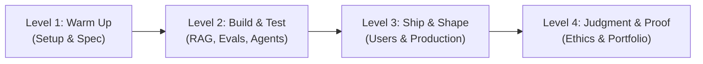

# Action Quests: Play the Curriculum

> **"Don't read it all. Play it as quests."**
> 
> We converted the comprehensive AI Engineer Study Guide into **13 small, progressive quests**. Each quest represents a few hours of focused engineering that ends in tangible proof you can add to your public portfolio.

You can track your quest progress interactively on the **[Boss of AI Quests Dashboard](https://bossofai.org/quests)**.

---

## 🏆 The 4 Quest Levels

---

## Level 1 — Warm Up
*Goal: Set up your workspace, make your first programmatic model call, and learn to specify before you build.*

### Quest 1: Set Up Your Workshop
* **Skill:** Software Fundamentals
* **Time:** 1 to 2 hours
* **Goal:** Have a working place to build: a GitHub repository, a Python/Node environment, and an AI coding assistant.
* **Proof Artifact:** Link to a public GitHub repo with a clean `README.md` and your first executed script.

### Quest 2: Talk to a Model from Code
* **Skill:** Build AI Apps
* **Time:** 2 hours
* **Goal:** Write a script that calls an LLM API, sends a system prompt, parses structured JSON, and handles rate-limit errors.
* **Proof Artifact:** Executable script and committed sample JSON response.

### Quest 3: Specify Before You Code
* **Skill:** Coding Agents
* **Time:** 2 hours
* **Goal:** Write a specification (`spec.md`) describing a tiny command-line utility. Feed the spec to a coding agent without writing code by hand, run the code, and confirm it passes tests.
* **Proof Artifact:** The committed `spec.md` and passing automated test logs.

---

## Level 2 — Build & Test
*Goal: Master retrieval, quantitative evaluation, and autonomous tool use. Measure whether your application actually works.*

### Quest 4: Ground a Model with Citations (RAG)
* **Skill:** Build AI Apps
* **Time:** 3 to 4 hours
* **Goal:** Ingest a 10-page document into a vector database or chunked text store. Ask questions and return answers that cite exact section numbers. Refuse to answer if information is absent.
* **Proof Artifact:** Script and a demonstration log showing grounded answers with clickable source citations.

### Quest 5: Build an Evaluation Harness
* **Skill:** Build AI Apps
* **Time:** 3 hours
* **Goal:** Write 10 test questions with reference answers for your RAG system. Build an automated script that grades output accuracy, reporting pass/fail percentages.
* **Proof Artifact:** The evaluation dataset (`evals.json`) and the test runner output report.

### Quest 6: Build a ReAct Agent with Tool Use
* **Skill:** Coding Agents
* **Time:** 4 hours
* **Goal:** Build an agent that reasons, picks from at least two tools (e.g. calculator, web search, weather API), executes them, and combines the results to answer complex user queries.
* **Proof Artifact:** Agent run transcript showing the Thought -> Action -> Observation -> Final Answer sequence.

---

## Level 3 — Ship & Shape
*Goal: Move from local scripts to deployed software used by real human beings. Stress-test your application with red teaming.*

### Quest 7: Put It on the Web
* **Skill:** Shape the Build
* **Time:** 3 to 4 hours
* **Goal:** Put a web interface on one of your previous projects and deploy it live to a public URL (e.g. Vercel, Fly.io, or Netlify).
* **Proof Artifact:** Public URL where anyone can interact with your live application.

### Quest 8: Watch a Real User
* **Skill:** Shape the Build
* **Time:** 2 hours
* **Goal:** Watch a peer or colleague use your deployed app without helping them. Note where they stumble, what confused them, and commit one specific UI/UX fix.
* **Proof Artifact:** User observation notes and a commit diff addressing their friction point.

### Quest 9: Try to Break It (Red-Teaming)
* **Skill:** Judgment & Responsibility
* **Time:** 2 hours
* **Goal:** Perform adversarial prompt injection, jailbreaking, and boundary testing against your live app. Document what caused failures and add defensive guardrails.
* **Proof Artifact:** Red-team security log and the defensive prompt / regex / validation fixes committed.

---

## Level 4 — Judgment & Proof
*Goal: Explain system behavior, take moral ownership of risks, showcase your work publicly, and help the next learner.*

### Quest 10: Explain Why It Said That (Explainability)
* **Skill:** Judgment & Responsibility
* **Time:** 2 hours
* **Goal:** Add an inspection view to your application exposing the system prompt, retrieved chunks, temperature, and token usage for any given response.
* **Proof Artifact:** Screenshot or video showing the developer transparency drawer in action.

### Quest 11: Write the Safety & Risk Memo
* **Skill:** Judgment & Responsibility
* **Time:** 2 hours
* **Goal:** Write a one-page risk memo for your application: What could go wrong? Who could be harmed? When should a human override the output?
* **Proof Artifact:** A committed `SAFETY.md` file adhering to Boss of AI governance standards.

### Quest 12: Publish Your Showcase
* **Skill:** Shape the Build
* **Time:** 3 hours
* **Goal:** Build a clean portfolio page linking all your quest artifacts, code repositories, live deployments, and evaluation scores.
* **Proof Artifact:** Public portfolio URL.

### Quest 13: Pay It Forward
* **Skill:** Community & Judgment
* **Time:** 2 hours
* **Goal:** Review a peer's quest project, submit a constructive GitHub Pull Request or issue, or mentor a junior student starting Level 1.
* **Proof Artifact:** Link to your public PR, code review, or mentoring session summary.

---

## 🚀 Ready to Play?

👉 Head over to **[bossofai.org/quests](https://bossofai.org/quests)** to track your progress, check off completed quests, and earn portfolio proof badges!
